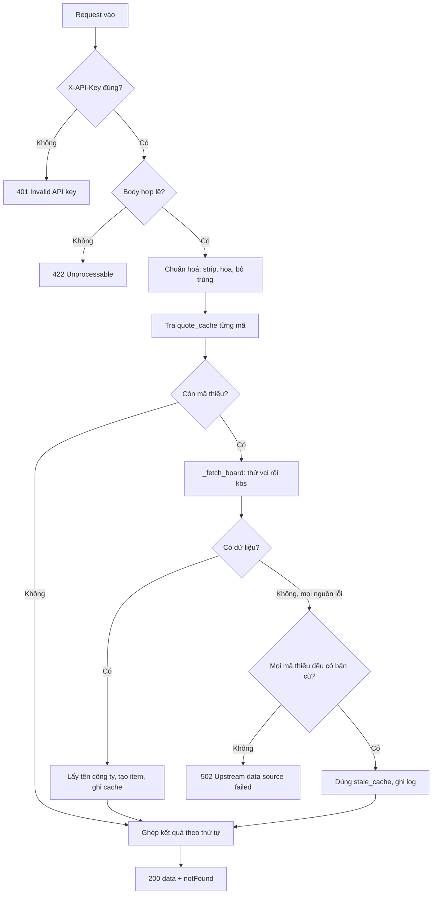

# Flow của `POST /api/v1/get-prices`

Tài liệu mô tả đường đi của một request, từ lúc vào nginx đến lúc trả JSON, và lý do
đằng sau từng bước. Code nằm trong [main.py](main.py), hàm `get_prices_by_symbols` và
`get_prices`.

## 1. Tổng quan

```
App Flutter
   │  POST https://nexxa.asia/stock/api/v1/get-prices
   ▼
nginx          ── HTTPS, rate limit, cắt tiền tố /stock
   │  POST http://127.0.0.1:8000/api/v1/get-prices
   ▼
uvicorn        ── 1 worker, nhiều luồng (threadpool)
   ▼
FastAPI        ── xác thực khoá → validate body → get_prices()
   ▼
cache + vnstock ── vci (ưu tiên) → kbs (dự phòng) → dữ liệu cũ
```

## 2. Request và response

```http
POST /api/v1/get-prices
X-API-Key: <STOCK_API_KEY>
Content-Type: application/json

{"symbols": ["ACB", "VCB"]}
```

```json
{
  "data": [
    {"symbol": "ACB", "name": "Ngân hàng Thương mại Cổ phần Á Châu", "exchange": "HOSE",
     "type": "STOCK", "price": 20500.0, "change": 250.0, "changePercent": 1.23, "logo": null}
  ],
  "notFound": []
}
```

| Trường | Ý nghĩa |
| --- | --- |
| `data` | Giá các mã tìm được, **theo đúng thứ tự gửi lên** |
| `notFound` | Mã upstream không có. Mã sai không gây lỗi, chỉ nằm ở đây |
| `price` | `close_price`; nếu chưa khớp lệnh (bằng 0) thì lấy giá tham chiếu |
| `change` | `price - reference_price` |
| `changePercent` | `change / reference_price * 100` |

## 3. Các bước xử lý



### Bước 1. Xác thực (`require_key`)

Là một `Depends`, chạy **trước** khi kiểm tra body. Nhờ vậy người không có khoá luôn nhận
`401`, kể cả khi họ gửi body sai. Họ không thấy được thông báo `422` chi tiết.

### Bước 2. Validate body (`PricesRequest`)

| Điều kiện | Kết quả |
| --- | --- |
| `symbols` thiếu hoặc rỗng | `422` |
| Nhiều hơn `MAX_SYMBOLS` (mặc định 100) | `422` |
| Có ký tự ngoài chữ và số, hoặc dài hơn 12 | `422` |
| `" vcb "`, `"acb"`, `"ACB"` | Đổi thành `VCB`, `ACB`, bỏ trùng, giữ thứ tự |

Giới hạn số mã là để chặn một request kéo cả thị trường. vnstock cho phép tối đa 500 mã
mỗi lần gọi.

### Bước 3. Tra cache từng mã

`quote_cache` lưu **theo từng mã**, không theo cả danh sách. Hai request có danh sách
khác nhau vẫn dùng chung dữ liệu, và chỉ những mã chưa có mới đi hỏi upstream.

| Giá trị trong cache | Ý nghĩa |
| --- | --- |
| một `dict` | Giá của mã, còn hạn (`QUOTE_CACHE_TTL`, mặc định 5 giây) |
| `None` | Upstream không biết mã này. Cache luôn để người spam mã sai không đốt hạn mức |
| không có | Chưa có hoặc đã hết hạn → cần hỏi upstream |

### Bước 4. Hỏi upstream (`_fetch_board`)

Thử lần lượt các nguồn trong `VNSTOCK_SOURCES` (mặc định `vci,kbs`):

- `vci` thường trả trong khoảng 1 giây.
- `kbs` là nguồn mặc định của vnstock nhưng thỉnh thoảng không trả dữ liệu. Mỗi lần
  như vậy vnstock thử 2 lần nên có thể tốn 6 đến 12 giây trước khi báo lỗi.
- Một nguồn lỗi thì ghi log cảnh báo và thử nguồn kế tiếp.

### Bước 5. Khi `board is None` (mọi nguồn đều lỗi)

```
missing = mã không có trong quote_cache
stale   = những mã trong missing mà stale_cache còn bản lấy thành công gần nhất

nếu len(stale) < len(missing):  → 502
ngược lại:                      → dùng stale, ghi log, trả 200
```

Quy tắc là **được cả hoặc không có gì**. Nếu gọi `[ACB, HPG]` khi nguồn lỗi, ACB có bản
cũ nhưng HPG chưa từng lấy được, thì cả request trả `502`. Lý do: lúc nguồn đang chết,
không phân biệt được "mã không tồn tại" và "không lấy được vì lỗi". Cho vào `notFound`
sẽ khiến app hiểu nhầm.

Bản cũ sống tối đa 1 giờ (`stale_cache`). Response **không** đánh dấu đây là dữ liệu cũ.

### Bước 6. Tạo item và ghi cache

Khi upstream trả dữ liệu:

1. Lấy tên công ty từ `_names()` (cache 24 giờ). Lỗi lấy tên thì `name = null`, giá vẫn trả.
2. `_to_item()` tính `price`, `change`, `changePercent`, nhân với `PRICE_SCALE`.
3. Với mỗi mã thiếu: ghi `quote_cache[s] = item` (hoặc `None` nếu upstream không có).
   Nếu có item thì ghi thêm vào `stale_cache`.

### Bước 7. Ghép kết quả

Duyệt `symbols` theo thứ tự gửi lên: mã có item vào `data`, mã không có vào `notFound`.

## 4. `with _lock` và vì sao cần

FastAPI chạy các hàm `def` thường trong threadpool, nên nhiều request chạy **song song
trên nhiều luồng**, cùng dùng chung `quote_cache`, `stale_cache`, `name_cache`.

`TTLCache` của `cachetools` **không an toàn khi dùng đa luồng**. Mỗi thao tác của nó là
một chuỗi nhiều bước nội bộ (một `dict` giữ dữ liệu, một danh sách liên kết giữ thứ tự
và hạn dùng, một bộ đếm kích thước):

| Thao tác | Việc nó làm bên trong |
| --- | --- |
| `cache[key]` | Tìm mục, **dời nó về cuối danh sách** (`move_to_end`), kiểm tra hạn |
| `cache[key] = v` | **Xoá các mục đã hết hạn**, nhường chỗ nếu đầy, rồi thêm mục mới và cập nhật kích thước |
| `key in cache` | Chỉ đọc, không đổi gì |

Nếu hai luồng chen vào giữa các bước đó, cấu trúc nội bộ có thể lệch nhau (ví dụ một luồng
đang duyệt danh sách để xoá mục hết hạn trong khi luồng kia chèn thêm).

```
Luồng A: cache[s] = item     ── đang xoá mục hết hạn, giữa chừng ──┐
Luồng B: cache[s2]           ── dời s2 về cuối danh sách đúng lúc ─┤ cùng sửa
Luồng C: cache[s3] = item2   ── thêm mục, cập nhật kích thước ─────┘ một cấu trúc
```

`_lock` biến các thao tác đó thành từng khối một: luồng nào vào `with _lock:` thì luồng
khác phải chờ ở cửa.

Ba quy tắc khi dùng khoá trong code này:

1. **Giữ khoá thật ngắn.** Chỉ bọc các lần đọc/ghi cache, mất vài micro giây.
2. **Không giữ khoá khi gọi mạng.** `_fetch_board()` và `_names()` chạy ngoài khoá. Nếu
   bọc cả lệnh gọi vnstock (1 đến 12 giây) thì mọi request khác bị đứng chờ.
3. **Không lồng khoá.** `_lock` là `threading.Lock`, không phải `RLock`. Luồng đang giữ
   khoá mà xin lại chính nó sẽ treo vĩnh viễn. Vì vậy `_names()` được gọi ngoài vùng khoá
   và tự xin khoá riêng bên trong.

### Lỗi thứ hai mà khoá không chữa được: "kiểm tra rồi lấy"

Cache có hạn dùng tính theo thời gian, nên mục có thể hết hạn **đúng giữa hai lệnh**, kể
cả khi chỉ có một luồng:

```python
if s in cache:       # t = 4.999s → True (còn 1ms)
    ...              #   thời gian trôi qua
    item = cache[s]  # t = 5.001s → hết hạn → KeyError
```

Đã dựng lại bằng đồng hồ giả: `'ACB' in c` trả `True`, ngay sau đó `c['ACB']` ném
`KeyError`. `Cache.get()` của thư viện cũng viết theo kiểu này nên không dùng thay thế được.

Cách đúng là **một lệnh duy nhất** bắt `KeyError`, đó là hàm `_cache_get()`:

```python
def _cache_get(cache, key):
    try:
        return cache[key]
    except KeyError:
        return _MISS      # _MISS, không phải None, vì None là giá trị hợp lệ
```

Kiểm chứng: 32 luồng gọi `get_prices` hơn 9.600 lần với cache hết hạn sau 10 mili giây.
Kiểu "kiểm tra rồi lấy" cũ ra 3 lỗi `KeyError`, bản dùng `_cache_get` ra 0 lỗi.

### Giới hạn còn lại

Vì không giữ khoá khi gọi mạng, hai request cùng cần một mã chưa có trong cache sẽ **cùng
gọi vnstock**, mỗi bên một lần, thay vì một bên chờ bên kia. Tổn thất chỉ là vài lượt gọi
thừa lúc cache vừa hết hạn. Nếu lưu lượng tăng đáng kể, cách sửa là thêm khoá riêng theo
từng mã để chỉ một luồng đi gọi, các luồng khác chờ kết quả.

## 4b. Endpoint nội bộ để debug cache

| Method | Path | Việc làm |
| --- | --- | --- |
| GET | `/api/v1/internal/cache` | Chụp các mục **còn hạn** của `quote_cache`, `stale_cache`, số tên trong `name_cache`. `?symbol=ACB,VCB` để lọc |
| DELETE | `/api/v1/internal/cache` | Xoá cả ba cache, trả số mục đã xoá. Request kế tiếp gọi lại vnstock |

Cách đọc kết quả của GET:

- `quote_cache.entries.ZZZZ = null` là cache âm: upstream không biết mã này.
- `stale_cache` là lưới an toàn của [bước 5](#bước-5-khi-board-is-none-mọi-nguồn-đều-lỗi).
  Xoá nó lúc vnstock đang lỗi thì request sau trả `502`.
- `name_cache` chỉ báo `loaded` và `count`, không đổ cả ~1.500 tên.

Bảo vệ ba lớp:

1. **Khoá riêng `X-Internal-Key`** (biến `INTERNAL_API_KEY`). Không dùng `STOCK_API_KEY`
   vì khoá đó nằm trong app Flutter, ai tải app cũng trích được. So sánh bằng
   `secrets.compare_digest`.
2. **Không đặt `INTERNAL_API_KEY` thì endpoint tắt** và trả `404`, như không tồn tại.
3. **nginx chặn** `/stock/api/v1/internal/` (`return 404`), nên chỉ gọi được trực tiếp trên
   server hoặc qua SSH tunnel. Hai endpoint này cũng không hiện trong `/docs`.

Cả hai dùng `_lock` và `_cache_get` như phần 4, nên an toàn khi chạy song song với request thật.

## 5. Mã trạng thái

| Mã | Khi nào |
| --- | --- |
| `200` | Có dữ liệu (mới hoặc cũ), `notFound` có thể khác rỗng |
| `401` | Thiếu hoặc sai `X-API-Key` |
| `422` | Body sai: rỗng, quá nhiều mã, ký tự lạ |
| `502` | Mọi nguồn lỗi và có mã thiếu chưa từng có bản cũ |

## 6. Cấu hình

| Biến | Mặc định | Tác dụng |
| --- | --- | --- |
| `STOCK_API_KEY` | (bắt buộc) | Khoá app gửi qua `X-API-Key` |
| `MAX_SYMBOLS` | `100` | Số mã tối đa mỗi request |
| `QUOTE_CACHE_TTL` | `5` | Giây cache giá mỗi mã |
| `VNSTOCK_SOURCES` | `vci,kbs` | Thứ tự thử nguồn dữ liệu |
| `PRICE_SCALE` | `1` | Nhân giá, đặt `0.001` để ra nghìn đồng |

Chạy **1 worker**: cache nằm trong tiến trình, nhiều worker thì mỗi worker có cache riêng
và gọi upstream riêng.

## 7. Hạn mức vnstock

Cache theo từng mã làm giảm số lượt gọi, nhưng với `QUOTE_CACHE_TTL=5` một mã nóng vẫn bị
hỏi upstream tối đa mỗi 5 giây, tức khoảng 17.000 lượt mỗi ngày nếu có người gọi liên tục.
Cấp Khách có hạn mức thấp (vài lần gọi đã dùng 4% của 24 giờ). Cân nhắc nâng TTL lên 30
đến 60 giây hoặc đăng ký khoá Cộng đồng (`vnstock register`).
